<!-- readme:start -->

<picture><source media="(max-width: 600px) and (prefers-color-scheme: dark)" srcset="assets/intro-narrow-dark.svg"><source media="(max-width: 600px)" srcset="assets/intro-narrow-light.svg"><source media="(prefers-color-scheme: dark)" srcset="assets/intro-wide-dark.svg"></picture> 
<a href="https://github.com/search?q=author%3AAxyss+is%3Apr+-user%3AAxyss&amp;type=pullrequests&amp;s=created&amp;o=desc"><picture><source media="(max-width: 600px) and (prefers-color-scheme: dark)" srcset="assets/contributions-narrow-dark.svg"><source media="(max-width: 600px)" srcset="assets/contributions-narrow-light.svg"><source media="(prefers-color-scheme: dark)" srcset="assets/contributions-wide-dark.svg"></picture></a> 
<a href="https://github.com/KaspianDev/AntiPopup/pull/141"><picture><source media="(max-width: 600px) and (prefers-color-scheme: dark)" srcset="assets/pr-1-narrow-dark.svg"><source media="(max-width: 600px)" srcset="assets/pr-1-narrow-light.svg"><source media="(prefers-color-scheme: dark)" srcset="assets/pr-1-wide-dark.svg"></picture></a> 
<a href="https://github.com/n00bcodr/Jellyfin-Enhanced/pull/954"><picture><source media="(max-width: 600px) and (prefers-color-scheme: dark)" srcset="assets/pr-2-narrow-dark.svg"><source media="(max-width: 600px)" srcset="assets/pr-2-narrow-light.svg"><source media="(prefers-color-scheme: dark)" srcset="assets/pr-2-wide-dark.svg"></picture></a> 
<a href="https://github.com/PaperMC/Paper/pull/13868"><picture><source media="(max-width: 600px) and (prefers-color-scheme: dark)" srcset="assets/pr-3-narrow-dark.svg"><source media="(max-width: 600px)" srcset="assets/pr-3-narrow-light.svg"><source media="(prefers-color-scheme: dark)" srcset="assets/pr-3-wide-dark.svg"></picture></a> 
<a href="https://github.com/jellyfin/jellyfin-android/pull/2139"><picture><source media="(max-width: 600px) and (prefers-color-scheme: dark)" srcset="assets/pr-4-narrow-dark.svg"><source media="(max-width: 600px)" srcset="assets/pr-4-narrow-light.svg"><source media="(prefers-color-scheme: dark)" srcset="assets/pr-4-wide-dark.svg"></picture></a> 
<a href="https://github.com/garethgeorge/backrest/pull/1250"><picture><source media="(max-width: 600px) and (prefers-color-scheme: dark)" srcset="assets/pr-5-narrow-dark.svg"><source media="(max-width: 600px)" srcset="assets/pr-5-narrow-light.svg"><source media="(prefers-color-scheme: dark)" srcset="assets/pr-5-wide-dark.svg"></picture></a>

<!-- readme:end -->
