I love building open source tools and trying out new tech. These days I'm mostly into self-hosting and trying the shiny new frontier model of the month.

<!-- stack:start -->

<picture><source media="(prefers-color-scheme: dark)" srcset="assets/section-stack-dark.svg"><source media="(prefers-color-scheme: light)" srcset="assets/section-stack-light.svg"></picture> 
<picture><source media="(prefers-color-scheme: dark)" srcset="assets/stack-dark.svg"><source media="(prefers-color-scheme: light)" srcset="assets/stack-light.svg"></picture>

<!-- stack:end -->

<!-- contributions:start -->

<a href="https://github.com/search?q=author%3AAxyss%20is%3Apr%20-user%3AAxyss&amp;type=pullrequests&amp;s=created&amp;o=desc"><picture><source media="(prefers-color-scheme: dark)" srcset="assets/section-contributions-dark.svg"><source media="(prefers-color-scheme: light)" srcset="assets/section-contributions-light.svg"></picture></a> 
<a href="https://github.com/KaspianDev/AntiPopup/pull/141"><picture><source media="(prefers-color-scheme: dark)" srcset="assets/pr-1-dark.svg"><source media="(prefers-color-scheme: light)" srcset="assets/pr-1-light.svg"></picture></a> 
<a href="https://github.com/n00bcodr/Jellyfin-Enhanced/pull/954"><picture><source media="(prefers-color-scheme: dark)" srcset="assets/pr-2-dark.svg"><source media="(prefers-color-scheme: light)" srcset="assets/pr-2-light.svg"></picture></a> 
<a href="https://github.com/PaperMC/Paper/pull/13868"><picture><source media="(prefers-color-scheme: dark)" srcset="assets/pr-3-dark.svg"><source media="(prefers-color-scheme: light)" srcset="assets/pr-3-light.svg"></picture></a> 
<a href="https://github.com/jellyfin/jellyfin-android/pull/2139"><picture><source media="(prefers-color-scheme: dark)" srcset="assets/pr-4-dark.svg"><source media="(prefers-color-scheme: light)" srcset="assets/pr-4-light.svg"></picture></a> 
<a href="https://github.com/garethgeorge/backrest/pull/1250"><picture><source media="(prefers-color-scheme: dark)" srcset="assets/pr-5-dark.svg"><source media="(prefers-color-scheme: light)" srcset="assets/pr-5-light.svg"></picture></a>

<!-- contributions:end -->
